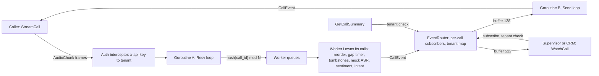

# AudioGateway

[](https://github.com/yoohooshantanu/streambridge/actions)


A gRPC gateway that takes live call audio in, hands it to AI workers, and streams the results back out to the caller and to anyone watching. Think of it as the switchboard in front of a speech pipeline: it does not understand speech, it makes sure frames arrive in order, results go to the right people, and one noisy call cannot hurt another.

*(The GitHub repo is called streambridge. The Go module, the binary, the gRPC service and the metrics are all named audio-gateway from a later rename.)*

---

## Contents

- [The idea in two minutes](#the-idea-in-two-minutes)
- [What is real and what is mocked](#what-is-real-and-what-is-mocked)
- [Architecture](#architecture)
- [The pieces, one by one](#the-pieces-one-by-one)
- [Protocol](#protocol)
- [Run it](#run-it)
- [Observability](#observability)
- [Tests](#tests)
- [Performance](#performance)
- [Limitations and rough edges](#limitations-and-rough-edges)
- [Repo map](#repo-map)

---

## The idea in two minutes

A phone call, to a machine, is a stream of tiny audio packets: 20 ms each, 50 per second. A voice AI backend has to take those packets, run transcription and analysis on them, and send results back while the call is still going. It also has to let other systems (a supervisor dashboard, a CRM) watch the same call live, without slowing the call down.

Four things go wrong in practice, and each is a design decision in this repo:
- **Packets arrive out of order or not at all**: The gateway reorders them in a bounded buffer, and gives up on a call that stays stuck.
- **Two threads writing to one stream corrupt it**: gRPC lets one goroutine receive while another sends, but not two senders. Each call gets exactly one of each.
- **A slow watcher must not slow the caller**: Watchers get a small buffer. If it fills up, their events are dropped and counted. The call never waits.
- **Tenant A must never see tenant B's call**: Every call is bound to the tenant that opened it, and every read path checks.

It is also built so that one call's work always lands on the same worker goroutine. That worker owns the call's state outright, so the hot path takes no per-call locks.

---

## What is real and what is mocked

| Real | Mocked or simplified |
| :--- | :--- |
| Bidirectional gRPC streaming, auth interceptors, tenant binding | The AI. The "transcriber" echoes a canned sentence per frame. Sentiment is a fixed payload every third frame. Intent is a fixed payload at the end of a call. No model runs. |
| Hash-partitioned worker pool, sequence reassembly, gap timeout, tombstones | Storage. Call summaries and tenant ownership live in process memory. Restart the server and they are gone. |
| Event router with tenant isolation and backpressure drops | Auth. API keys come from environment variables. There is no TLS on the gRPC port. |
| Prometheus metrics, health service, pprof | Real audio. Frames are opaque bytes. If a frame's data starts with `text:` the "transcriber" uses the rest as the transcript, which is how the tests feed it speech. |
| 22 tests plus 4 benchmarks, run with the race detector in CI | This is a transport-and-concurrency project. The model behind the worker is meant to be swapped in later. |

---

## Architecture



Three RPCs: `StreamCall` (bidirectional, the caller), `WatchCall` (server stream, observers), `GetCallSummary` (unary, after the call). A separate HTTP sidecar serves `/healthz`, `/metrics` and, if enabled, pprof.

---

## The pieces, one by one

### One reader, one writer per stream (`internal/server`)

`StreamCall` splits each stream into two goroutines:
- **Goroutine A** is the only one that ever calls `stream.Recv()`: it validates each frame and submits it to the worker pool.
- **Goroutine B** (the handler goroutine itself) is the only one that ever calls `stream.Send()`: it drains the call's event channel.

They coordinate through a done channel and an error channel, and a panic in either is recovered into a `codes.Internal` instead of crashing the process.

When the caller finishes sending, goroutine B keeps draining until it sees `EVENT_CALL_ENDED`, so the caller gets its final transcript and the stream ends cleanly. A cancelled context wins over everything. `TestStreamCallContextCancellationDuringDrain` covers that path.

### Hash-partitioned workers (`internal/worker`)

Each frame is routed to worker `fnv1a(call_id) mod N`. The same call always lands on the same worker, so that worker can keep the call's state in plain maps with no locks:

```go
sessions     map[callID]*callSession // next expected sequence, pending frames, timers
abortedCalls map[callID]time.Time    // tombstones
```

Per-worker queues are channels sized `queueCapacity / workers` (at least 64; the server uses 2048 total, so 512 each at the default 4 workers). If a queue is full, `Submit` blocks, which stops the receive loop, which stops reading from the HTTP/2 stream, which pushes back on the sender through flow control. Overload slows the caller down instead of growing memory.

One honest caveat on "share-nothing": per-call state is owned by one worker, but event sequence numbers come from a single process-wide atomic counter. They increase within a call, with gaps, because other calls' events take numbers too.

### Reassembling out-of-order frames

A new session expects sequence 1. For each frame:
- **Already processed** (sequence below the expected one): dropped, counted as a duplicate.
- **Exactly the expected one**: processed, then any buffered frames that are now contiguous are drained in order.
- **Ahead of the expected one**: buffered in `pendingChunks`, with two limits:
  - More than 64 buffered frames per call, or a frame more than 128 ahead of the expected sequence, and the frame is dropped and the caller gets an `EVENT_CALL_ERROR` (`pending_buffer_saturated` or `excessive_sequence_gap`). The call keeps going.
- **Sequence 0**: treated as unsequenced and processed immediately.

The final frame (`is_final`) goes through the same path, so finalization cannot race ahead of frames that arrive before it. `TestOutOfOrderChunkArrivalSequencing`, `TestInitialSequenceGapReassembly`, `TestDuplicateSequenceDrop` and `TestPendingChunksBufferBounds` cover the cases.

### What happens when a frame never arrives

A gap does not wait forever. When the first out-of-order frame is buffered, the session records a start time. Each worker has a 100 ms ticker, and if a gap stays open for 2 seconds (`DefaultGapTimeout`), the worker:
1. Emits `EVENT_CALL_ERROR` with `sequence_gap_timeout`,
2. Deletes the session and its buffered frames,
3. Records a tombstone for the call.

The stream handler sees that event and ends the RPC with `codes.DataLoss`. `TestGapTimeoutSessionTermination` drives it.

### Tombstones: no zombie calls

If a late or retransmitted frame arrived after the abort and the worker had no memory of the call, it would create a fresh session expecting sequence 1 and start a ghost call. So the worker remembers aborted call IDs for 60 seconds, up to 1,024 per worker, and drops frames for them (counted as `late_frames_tombstone_dropped`). When the table is full the oldest tombstone is evicted so the newest abort is always protected. Because a worker owns its calls, none of this needs a lock. `TestFrameArrivingAfterGapTimeoutAbort` and `TestTombstoneCapacityEviction` cover it. Idle sessions with no activity for 15 minutes are evicted by the same ticker.

### The event router (`internal/router`)

The router is the fan-out hub: `map[callID][]chan *CallEvent` behind a `sync.RWMutex`. The caller's own stream subscribes with a 128-event buffer and each `WatchCall` watcher with 512.

Publish takes the read lock and does a non-blocking send to every subscriber:

```go
for _, ch := range subs {
    select {
    case ch <- event:
    default:
        metrics.DefaultMetrics.IncDropped() // slow consumer: drop, never wait
    }
}
```

Unsubscribing takes the write lock before closing the channel, so a `Publish` can never send on a closed channel. `TestSubscriberBufferSaturationBackpressureDrop` fills a watcher's buffer and checks that the stream still completes and the drops are counted. `TestWatchCallFanOut` checks that a watcher sees the same events.

The tradeoff is deliberate and worth stating: the ingest side applies backpressure (workers slow the caller down), while the output side drops (slow subscribers lose events). Real-time voice would rather lose a dashboard update than add latency to the call. The caller's own event channel is also a router subscriber, so it too can drop events if it stops reading.

### Tenants and auth

Authentication is an interceptor on both unary and stream RPCs. It reads the `x-api-key` metadata header and looks the key up in an exact-match map (no prefix matching). Unknown or missing keys get `codes.Unauthenticated`. The standard gRPC health service is exempt.

Keys come from the environment: `STREAMBRIDGE_API_KEY=<key>` maps one key to the tenant `tenant_production`, and `STREAMBRIDGE_API_KEYS="key1:tenantA,key2:tenantB"` maps several. With neither set, every call is rejected. There are no built-in test keys (`TestProductionRegistryStartsEmpty`).

Ownership is bound on the first frame: the call ID is registered to the authenticated tenant. A `tenant_id` in a frame that disagrees with the authenticated tenant is `PermissionDenied`. Another tenant calling `WatchCall` or `GetCallSummary` on that call ID is `PermissionDenied` too (`TestTenantIsolationCrossTenantAccessBlocked`).

### The mock worker pipeline

Per frame, the worker emits a partial transcript (`Speaker audio frame N acknowledged (M bytes)`, or the text after a `text:` prefix). Every third frame it emits a sentiment event (`positive`, or `neutral` when the frame count is also even). On the final frame it emits a final transcript (a canned line, or the text after a `final_text:` prefix), an intent event, `EVENT_CALL_ENDED`, and stores a `CallSummary`. Payloads are strongly typed structs, or pre-built constant strings for the fixed ones, so JSON escaping is correct (`TestSpecialCharactersInTranscriptJSON` pushes quotes, backslashes, newlines and emoji through) and the fixed ones allocate nothing.

`WatchCall` ends when it sees `EVENT_CALL_ENDED` or any `EVENT_CALL_ERROR`.

---

## Protocol

Defined in `proto/streambridge.proto`:

| RPC | Type | Purpose |
| :--- | :--- | :--- |
| `StreamCall(stream AudioChunk) returns (stream CallEvent)` | Bidirectional streaming | Send frames, receive events for your call |
| `WatchCall(WatchRequest) returns (stream CallEvent)` | Server streaming | Observe a live call you are allowed to see |
| `GetCallSummary(SummaryRequest) returns (CallSummary)` | Unary | Post-call transcript, sentiment, intent, duration, counts |

- **`AudioChunk`**: `call_id`, `tenant_id`, `sequence` (starts at 1), `data`, `is_final`, `timestamp`.
- **`CallEvent`**: `call_id`, `type`, `payload` (JSON string), `sequence`, `timestamp`.
- **Event types**: `TRANSCRIPT_PARTIAL`, `TRANSCRIPT_FINAL`, `SENTIMENT`, `INTENT_DETECTED`, `CALL_ENDED`, `CALL_ERROR`.
- **gRPC status codes you can see**: `Unauthenticated` (bad or missing key), `PermissionDenied` (wrong tenant), `InvalidArgument` (empty call ID), `NotFound` (no summary yet), `DataLoss` (sequence gap timeout), `Unavailable` (send failed).

---

## Run it

```bash
git clone https://github.com/yoohooshantanu/streambridge
cd streambridge
export STREAMBRIDGE_API_KEYS="dev_key:tenant_dev"
go run ./cmd/server
# gRPC on :50051, HTTP sidecar on 127.0.0.1:8083
```

Minimal Go client:

```go
conn, _ := grpc.NewClient("127.0.0.1:50051", grpc.WithTransportCredentials(insecure.NewCredentials()))
client := pb.NewAudioGatewayClient(conn)
ctx := metadata.AppendToOutgoingContext(context.Background(), "x-api-key", "dev_key")
stream, _ := client.StreamCall(ctx)

stream.Send(&pb.AudioChunk{CallId: "call-1", Sequence: 1, Data: []byte("text:hello there")})
stream.Send(&pb.AudioChunk{CallId: "call-1", Sequence: 2, Data: []byte("final_text:hello there, bye"), IsFinal: true})
stream.CloseSend()

for {
    ev, err := stream.Recv()
    if err != nil {
        break
    }
    fmt.Println(ev.Type, ev.Payload)
}
```

Send frames out of order, or skip one, to watch the reassembly and the gap timeout.

### Configuration

| Setting | Default | Notes |
| :--- | :--- | :--- |
| `GRPC_PORT` | `50051` | gRPC server listening port |
| `HTTP_PORT` | `8083` | `/healthz`, `/metrics`, pprof |
| `HTTP_HOST` | `127.0.0.1` | Set to `0.0.0.0` inside a container, or published port is unreachable |
| `WORKER_POOL_SIZE` or `-workers` | `4` | Flag wins over env |
| `PPROF_ENABLED` | `off` | `true` or `1` also turns on block and mutex profiling |
| `STREAMBRIDGE_API_KEY`, `STREAMBRIDGE_API_KEYS` | none | See above. No keys means every call is rejected |

`make build`, `make test`, `make bench`, `make run` and `make docker-build` exist. Shutdown is graceful: gRPC gets 5 seconds to drain active streams, then the pool stops, then the router closes.

---

## Observability

The HTTP sidecar serves Prometheus metrics at `/metrics`:
`audio_gateway_active_streams`, `audio_gateway_active_watchers`, `audio_gateway_audio_packets_total`, `audio_gateway_audio_bytes_total`, `audio_gateway_events_emitted_total`, `audio_gateway_events_dropped_total`, `audio_gateway_duplicate_frames_dropped_total`, `audio_gateway_late_frames_tombstone_dropped_total`, `audio_gateway_sequence_gap_timeouts_total`, `audio_gateway_worker_queue_depth`, `audio_gateway_packet_queue_wait_seconds`, `audio_gateway_packet_processing_seconds`, `audio_gateway_grpc_requests_total`, `audio_gateway_grpc_request_duration_seconds`.

Two are worth knowing about:
- **Queue wait** (`audio_gateway_packet_queue_wait_seconds`): how long a frame sat in a worker's queue before it was picked up.
- **Processing** (`audio_gateway_packet_processing_seconds`): how long the worker spent on it.

Together you can distinguish "workers are slow" from "workers are starved". Labels are kept low-cardinality on purpose: `TestCardinalitySafety1000CallsConstantSeriesCount` runs 1,000 calls and checks the number of metric series does not grow with call IDs. Logs are structured and carry `call_id` and `tenant_id` (`TestStructuredLoggingCarriesCallID`). pprof is off unless `PPROF_ENABLED` is set.

---

## Tests

22 test functions and 4 benchmarks, in `tests/` and `internal/worker/`. CI runs them with `go test -race` on every push. The gRPC tests run over an in-memory `bufconn` listener, so they use no real ports and exercise the full interceptor chain.

```bash
go test -v -race ./tests/... ./internal/...
go test -bench=BenchmarkAudioGatewayThroughput -benchmem -run='^$' ./tests/...
```

| Area | Tests |
| :--- | :--- |
| **Auth and keys** | `TestAuthInterceptorRejections`, `TestProductionRegistryStartsEmpty` |
| **Streaming** | `TestBidirectionalStreamCall`, `TestStreamCallContextCancellationDuringDrain`, `TestStreamCallEmptyCallIDRejection` |
| **Tenants** | `TestTenantIsolationCrossTenantAccessBlocked` |
| **Reassembly and gaps** | `TestOutOfOrderChunkArrivalSequencing`, `TestInitialSequenceGapReassembly`, `TestDuplicateSequenceDrop`, `TestPendingChunksBufferBounds`, `TestGapTimeoutSessionTermination` |
| **Tombstones** | `TestFrameArrivingAfterGapTimeoutAbort`, `TestTombstoneCapacityEviction` |
| **Fan-out and backpressure** | `TestWatchCallFanOut`, `TestSubscriberBufferSaturationBackpressureDrop` |
| **Observability** | `TestPrometheusOfficialMetricsRegistered`, `TestActiveStreamsGaugeDecrementedOnAllExitPaths`, `TestStructuredLoggingCarriesCallID`, `TestCardinalitySafety1000CallsConstantSeriesCount`, `TestSubMillisecondPacketLatencyHistograms` |
| **Payloads and hashing** | `TestSpecialCharactersInTranscriptJSON`, `TestHashCallIDEquivalence` |

Not covered by tests: shutdown under load, the `WatchCall` termination rules, and many concurrent calls hitting the same worker.

---

## Performance

All numbers below are from one Windows laptop (AMD Ryzen 5 3500U, 4 cores, 8 GB) with the load generator and the server on the same machine over loopback, so they fight for the same CPU. Treat them as "how the design behaves under contention", not as capacity. The full raw run output (including per-step timings, knee triggers, and histogram bucket appendix) is committed at [loadtest_profiles/raw_loadtest_output.txt](loadtest_profiles/raw_loadtest_output.txt).

### A profile-driven cleanup

Profiling the concurrent out-of-order benchmark (20 simultaneous calls with scrambled frames) showed two costs: dynamic `json.Marshal(map[string]interface{}{...})` per event, and a 512-slot channel allocated for every stream. The fixes were typed payload structs, pre-built constant payloads for fixed events, and a 128-slot stream buffer. `benchstat` over 10 runs each:

| Metric | Before | After | Change |
| :--- | :--- | :--- | :--- |
| **Time per op** | 5.125 ms | 4.370 ms | **-14.7%** |
| **Bytes per op** | 895.7 KiB | 712.8 KiB | **-20.4%** |
| **Allocations per op** | 15.73k | 12.97k | **-17.6%** |

The buffer and JSON changes were made together, so the gain cannot be split between them. The smaller buffer also means a slow subscriber starts dropping events sooner.

A smaller one: replacing the `hash/fnv` interface calls with an inlined FNV-1a loop took the call-ID hash from about 69 ns to about 35 ns. `TestHashCallIDEquivalence` checks it matches `fnv.New32a` over 10,000 random IDs. At roughly 20 µs of service time per frame this barely registers.

### Load test

`cmd/loadgen` simulates calls sending 20 ms frames (50 per second each), ramping through concurrency steps, three runs per step, with warmup discarded and the server restarted between runs. Server-side numbers come from the server's own Prometheus metrics, not from the client.

```bash
go build -o bin/audio-gateway ./cmd/server
go build -o bin/loadgen ./cmd/loadgen
./bin/loadgen -steps="50,100,200,400,800" -step-duration=15s -runs=3 -auto-restart=true \
  -server-bin=./bin/audio-gateway -api-key=sb_loadtest_key
```

*(The server must know the key: `STREAMBRIDGE_API_KEYS="sb_loadtest_key:tenant_load"`.)*

| Concurrent calls | Offered pps | Achieved pps (3 runs) | Queue wait p99 | Client round trip p99 | Host CPU |
| :--- | :--- | :--- | :--- | :--- | :--- |
| **50** | 2,500 | 2,502 to 2,505 | 1.2 to 1.8 ms | 5 to 9 ms | 60 to 82% |
| **100** | 5,000 | 5,008 to 5,011 | 1.0 to 7.4 ms | 7 to 79 ms | 75 to 91% |
| **200** | 10,000 | 9,691 to 9,891 | 8.6 to 34 ms | 57 to 215 ms | 93 to 99% |
| **400** | 20,000 | 16,331 to 20,029 | 17 to 231 ms | 75 to 1,163 ms | 100% |
| **800** | 40,000 | 22,202 to 38,570 | 88 to 245 ms | 180 to 3,053 ms | 100% |

What it says: the time a worker actually spends on a frame stays under 1 ms and the workers are only 1 to 29% busy at every step, yet delays grow. The profile points the same way: mutex time sits mostly in gRPC's own stream write path (about 49%), and worker dispatch locks account for under 6%. The bottleneck on this machine is gRPC transport plus a CPU shared with the load generator, not the worker design. A caller sees the knee earlier than the server does: at 200 calls the server-side numbers are still small, but client round trips already cross 50 ms.

Raising workers from 4 to 16 at 400 calls cut p99 queue wait (87 to 159 ms down to 39 to 47 ms), but the host stayed pegged at 99% CPU. The 8-worker runs were too noisy to rank.

---

## Limitations and rough edges

1. **No real AI, no real audio**: See the table above.
2. **State is in memory**: Summaries (capped at 10,000, with arbitrary eviction when exceeded) and tenant ownership are lost on restart. Call-to-tenant entries are never cleaned up, so a long-running process slowly accumulates them.
3. **No TLS on the gRPC listener**, and API keys are static and compared as ordinary strings.
4. **The sequence-gap stream termination** is detected by searching the error event's payload text for `sequence_gap_timeout`. It works, but it is fragile compared with a typed signal.
5. **No gRPC reflection**: Reflection is not registered on the gRPC port; clients need `proto/streambridge.proto` (package `audiogateway.v1`, standard protoc-compatible) to generate stubs.
6. **Load test caveats**: Single machine, generator and server competing for CPU, and a laptop that throttles under sustained 100% host CPU load.

---

## Repo map

| Path | Description |
| :--- | :--- |
| `cmd/server/` | Server wiring, config, graceful shutdown, HTTP sidecar |
| `cmd/loadgen/` | Load generator with paced frames, pprof capture, server restarts |
| `internal/server/` | `StreamCall`, `WatchCall`, `GetCallSummary` handlers |
| `internal/worker/` | Hash-partitioned pool, reassembly, gap timeout, tombstones, mock engines |
| `internal/router/` | Fan-out hub, tenant ownership, summaries, backpressure drops |
| `internal/interceptor/` | Auth (`x-api-key` to tenant) and logging interceptors |
| `internal/metrics/` | Prometheus metrics |
| `internal/health/` | Standard gRPC health service |
| `internal/pb/` | Generated message and service code |
| `proto/` | Service definition |
| `tools/gen.go` | Custom descriptor-based stub generator |
| `tests/` | Integration tests over in-memory gRPC, plus benchmarks |

---

## Author

Shantanu Juvekar, [@yoohooshantanu](https://github.com/yoohooshantanu).
